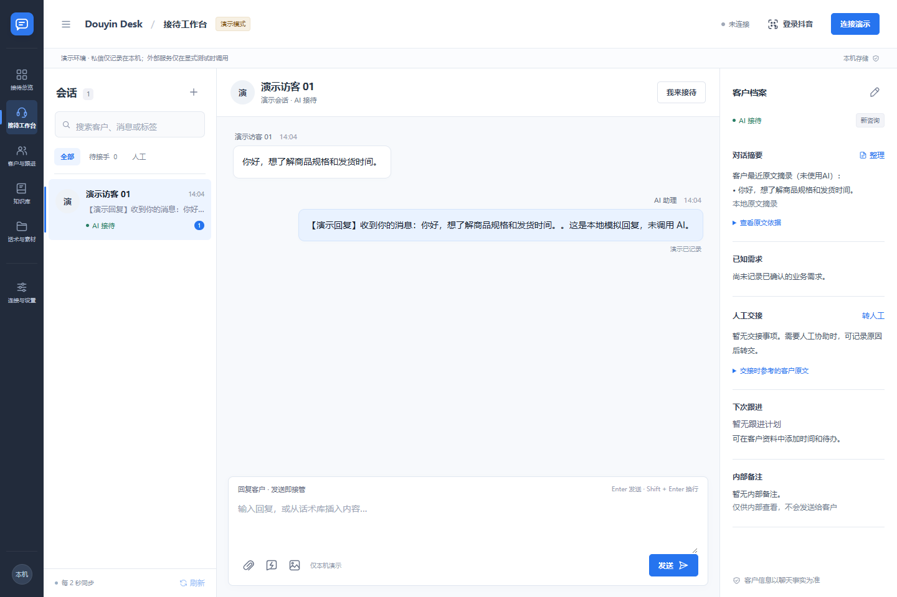

# 抖音私信客服工作台 · Douyin Inbox Desk

把私信接待、AI 回复、人工交接和客户跟进放进一个本地工作台。

[](https://www.python.org/)
[](LICENSE)

面向需要在 Windows 上管理抖音单聊私信的个人和小团队。支持浏览器面板与桌面窗口，聊天与配置保存在本机 SQLite，模型接口由使用者自行配置。新安装默认演示模式，可先体验界面和人工接管流程。



> 截图使用独立演示数据。项目为第三方适配工具，与抖音官方无隶属关系；真实连接依赖平台接口和账号状态，不保证长期兼容。

## 能做什么

| 区域 | 功能 |
| --- | --- |
| 私信接待 | 会话列表、聊天记录、AI 回复、人工接管、恢复 AI、待人工队列 |
| 客户跟进 | 客户标签、确认需求、内部备注、阶段及跟进时间 |
| 知识库 | 文本及 TXT/Markdown 导入，草稿/发布，对客/内部隔离，本地检索 |
| 话术与素材 | 快捷回复、图片与文件管理，编辑后发送 |
| 连接设置 | 抖音登录、模型配置、外部知识库与 Agent 咨询接口 |
| 接待可靠性 | 消息去重、断线补查、发送结果不明时停止自动重试 |

自动回关为独立可选开关，默认关闭；首次扫描建立基线，后续处理新增粉丝。媒体识别与发送能力受消息类型、接口和模型支持范围限制。

## 快速体验（无需账号和模型密钥）

安装 Python 3.12，在 Windows PowerShell 中执行：

```powershell
git clone https://github.com/744219288/douyin-inbox-desk.git
cd douyin-inbox-desk
py -3.12 -m venv .venv
.venv\Scripts\python.exe server.py --open
```

浏览器打开 `http://127.0.0.1:8765`。点击“模拟一条私信”，体验回复、人工接管和恢复 AI。基础演示使用 Python 标准库；附件等扩展功能需安装依赖。按 Ctrl+C 停止服务。

## 连接真实账号

1. 阅读 [第三方依赖说明](THIRD_PARTY_NOTICES.md)，单独获取固定版本依赖：`powershell -ExecutionPolicy Bypass -File scripts/fetch_vendor.ps1`。
2. 安装依赖：`.venv\Scripts\python.exe -m pip install -r requirements-live.txt`。
3. 本机安装 Edge 或 Chrome，运行 `.venv\Scripts\python.exe login.py`，在独立浏览器里完成官网登录。登录成功与私信连接成功是两个步骤。
4. 在面板设置中填写模型、API Key 和客服要求，选择真实模式，保存后连接账号。**连接后会自动处理符合条件的私信并发送回复**，请先用自己的测试会话核对。
5. 程序重启不自动连接抖音。需要暂停时断开连接；单个会话可人工接管。

只复制 Cookie 可能缺少发送所需的配套签名信息。登录状态保存在本机 `data/`，不要上传或分享。

## 桌面版与开发

```powershell
.venv\Scripts\python.exe -m pip install -r requirements-desktop.txt
.venv\Scripts\python.exe desktop.py
# 完整离线单元测试需要先获取上述协议依赖
.venv\Scripts\python.exe -m unittest discover -s tests -v
# 构建桌面版
.venv\Scripts\python.exe -m PyInstaller --noconfirm --clean desktop.spec
```

桌面窗口需要 Windows WebView2。依赖锁定快照见 `requirements-*.lock.txt`；未附带预构建 EXE。测试使用临时数据库和模拟传输，不代表真实平台送达验收。

## 文档

- [工作面板与接待流程](docs/WORKBENCH.md)
- [架构、接口与开发说明](docs/DEVELOPMENT.md)
- [验证记录](docs/VERIFICATION.md)
- [第三方来源](THIRD_PARTY_NOTICES.md) · [参与贡献](CONTRIBUTING.md) · [数据与安全](SECURITY.md)

## 使用边界

当前以单机、单账号、一对一私信为主，不提供团队权限、云端 CRM 或群聊客服。知识检索为本地词项匹配，不是向量数据库。外部 Agent 接口用于查询与咨询，服务内部行为由部署者负责。限频与断线可能延迟补查；发送结果不明时请到官方客户端核实。

自己的工作台代码采用 [MIT](LICENSE)；第三方组件按各自许可使用。另一个独立项目：[FeigeDesk 飞鸽客服工作台](https://github.com/744219288/feigedesk)。
