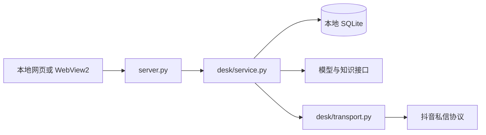

# 架构与开发

入口为 `server.py`、`desktop.py` 和 `login.py`。`desk/workspace.py` 管理知识、客户和素材，`desk/recovery.py` 与 `desk/stranger_polling.py` 负责补查，`desk/follow_back.py` 管理独立回关任务。
界面在 `static/`，接口细节见 [WORKSPACE_CONTRACT.md](../WORKSPACE_CONTRACT.md)。

开发时使用 `python server.py --data-dir <新的测试目录>`。禁止把测试目录指向日常使用的数据目录。
修改私信逻辑时重点验证：账号隔离、消息去重、待人工状态、接管取消待发任务和发送未知结果。
外部服务协议的离线样例位于 `scripts/mock_extensions.py`。
