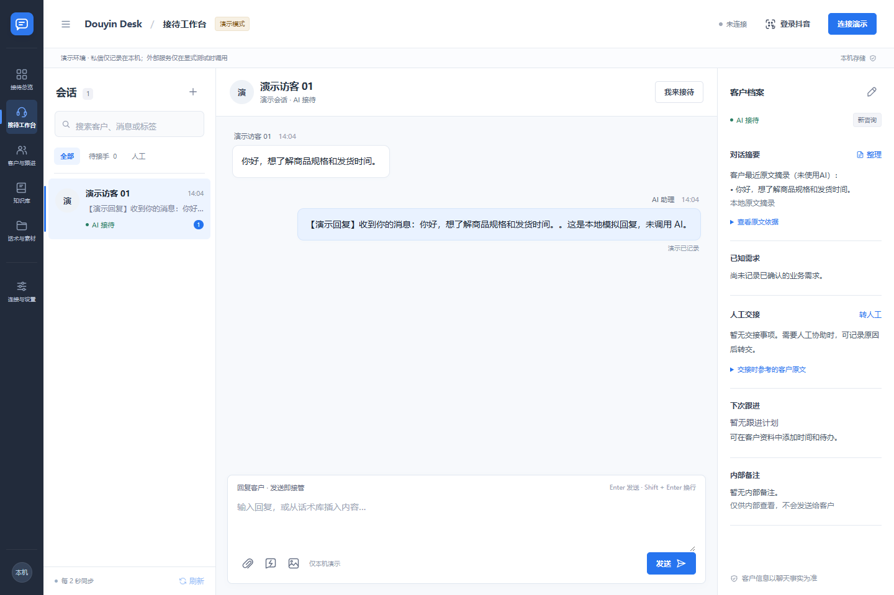

# 工作面板说明

## 从左到右看接待区

左侧导航切换私信接待、客户跟进、知识库、话术素材和连接设置；会话列表用于查找客户及查看待处理状态。
中间为当前会话的消息流和回复编辑器，右侧为客户资料与交接信息。切换客户时先确认当前会话，再编辑和发送。

## 一次接待怎么完成

1. 在演示模式模拟咨询，或在真实模式连接账号接收入站私信。
2. AI 根据会话上下文、客服要求及可用对客知识生成回复。
3. 客户要求真人或处理异常时，会话进入待人工。点击接管，AI 暂停；人工可编辑回复。
4. 把已确认的需求、标签和下一次跟进时间记入客户资料。内部备注不作为公开知识。
5. 点击恢复 AI 后，只处理之后的新消息，不追发接管期间的旧消息。

## 知识与素材怎么维护

知识先保存草稿，核对后发布；仅已发布、允许对客的内容用于本地检索。检索测试可以帮助检查召回内容。
话术先插入编辑器再修改发送。上传附件到素材库不等于已经把它解析成知识。
客户摘要中的模型分析需核对原文；有新消息时旧分析可能过时。

## 连接和状态怎么看

官网登录成功、实时连接成功、实际送达是不同状态。陌生人补查受限频影响可能延迟。
出现失败或结果未知时先核对官方会话，避免重复回复。关闭服务前可先断开账号。
自动回关独立控制，默认关闭，不影响基本私信体验。
